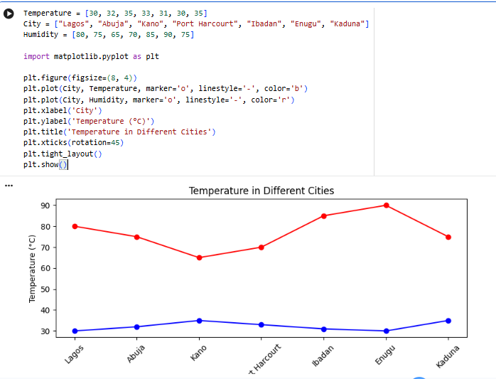
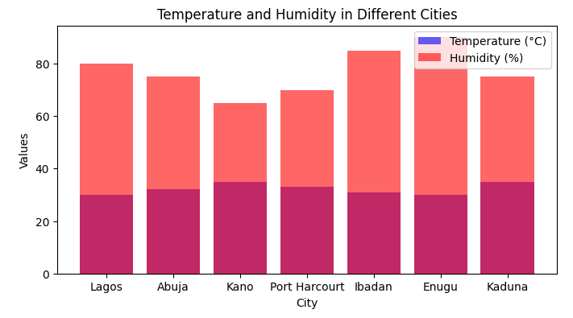

# Exploring Temperature and Humidity Across Seven Nigerian Cities

A Python data visualisation project exploring and comparing temperature and humidity observations across seven Nigerian cities using Matplotlib.

> **Project status:** Portfolio project, initial analysis and visualisations documented. The dataset has been described as real-world data, but its original source, collection dates, and measurement method have not yet been provided. These details must be added before the dataset can be independently verified.

## Project Overview

This project examines temperature and humidity values recorded for Lagos, Abuja, Kano, Port Harcourt, Ibadan, Enugu, and Kaduna. The analysis uses Python to organise the observations and Matplotlib to display differences between the cities.

The focus is on identifying variations in the supplied observations, comparing the highest and lowest values, and presenting the results through visualisations.

The analysis is descriptive. It does not establish why the cities differ or whether the observations represent their typical weather conditions.

## Business Problem

Understanding how environmental measurements vary across geographical locations can provide useful context for comparative analysis and reporting.

This project investigates how temperature and humidity values differ across seven selected Nigerian cities. It focuses on presenting the observations clearly and identifying patterns that can be explored further.

The central analytical question is:

**How do temperature and humidity vary across the selected Nigerian cities, and how can these differences be communicated effectively through data visualisation?**

This is an independent portfolio project, not a commissioned business engagement.

## Project Objectives

- Compare temperature observations across seven Nigerian cities.
- Examine humidity variations across the same locations.
- Identify the highest and lowest recorded values.
- Calculate descriptive averages for both measurements.
- Develop visual representations using Python and Matplotlib.
- Evaluate appropriate visualisation techniques for comparing measurements with different units.

## Analytical Questions

1. Which city has the highest and lowest temperature in the supplied observations?
2. Which city records the highest and lowest humidity?
3. How do temperature and humidity values vary across the selected cities?
4. What differences can be observed between the two measurements?
5. Which visualisation techniques communicate the results most effectively?

## Dataset Description

The dataset contains seven observations and three variables.

| Column | Description | Data Type |
|---|---|---|
| City | Name of the Nigerian city | Categorical |
| Temperature | Recorded temperature for each city | Numeric (°C) |
| Humidity | Recorded humidity for each city | Numeric (%) |

### Dataset Preview

| City | Temperature (°C) | Humidity (%) |
|---|---:|---:|
| Lagos | 30 | 80 |
| Abuja | 32 | 75 |
| Kano | 35 | 65 |
| Port Harcourt | 33 | 70 |
| Ibadan | 31 | 85 |
| Enugu | 30 | 90 |
| Kaduna | 35 | 75 |

**Dataset source:** Described by the project owner as real-world data. Original source and collection details are not yet available.

**Geographical coverage:** Seven Nigerian cities.

**Dataset size:** 7 observations and 3 columns.

**Observation period:** Not yet established.

**Data classification:** Real-world data, as reported by the project owner; independent source verification is pending.

## Tools and Technologies

| Technology | Purpose |
|---|---|
| Python | Representing and working with the dataset |
| Matplotlib | Creating data visualisations |
| Jupyter Notebook | Development and execution environment |

The project uses Python lists to organise the city names, temperature values, and humidity values before plotting them with Matplotlib.

No additional libraries are claimed because their use has not been established by the available project evidence.

## Analytical Methodology

The project follows an introductory data analysis and visualisation workflow.

### 1. Data Representation

The observations were organised into Python lists containing:

- City names.
- Temperature values.
- Humidity values.

### 2. Library Importation

Matplotlib's `pyplot` module was imported using the alias `plt` to support chart creation and formatting.

### 3. Line Chart Development

A line chart was created to display temperature and humidity observations across the seven cities.

The implementation includes:

- Line plots with markers.
- Different colours for the two measurements.
- Chart title.
- Axis labels.
- Rotated city labels.
- Layout adjustment.

### 4. Bar Chart Visualisation

A second chart was created to provide another visual comparison of temperature and humidity across the cities.

### 5. Analytical Interpretation

The values were examined to identify the maximum, minimum, and average observations for both measurements.

The visualisations were also reviewed to identify improvements in chart selection and presentation.

## Project Visualisations

### 1. Temperature and Humidity Line Chart

The line chart presents the temperature and humidity observations across the seven cities.

It provides an initial view of how the two measurements vary from one location to another.



### 2. Temperature and Humidity Bar Chart

The bar chart provides an alternative representation of the observations, allowing the values to be examined by city.

The current implementation requires improvement because the bars overlap rather than appearing side by side.



**Visualisation improvement:** Since temperature and humidity have different measurement units, separate charts or clearly labelled axes are recommended for more accurate interpretation. A grouped bar chart would also improve the city-level comparison.

## Key Findings and Analytical Insights

Based on the seven observations supplied for the analysis, the following results were identified.

### Temperature Analysis

- **Highest temperature:** Kano and Kaduna, both recording 35°C.
- **Lowest temperature:** Lagos and Enugu, both recording 30°C.
- **Average temperature:** Approximately 32.29°C.

### Humidity Analysis

- **Highest humidity:** Enugu, recording 90%.
- **Lowest humidity:** Kano, recording 65%.
- **Average humidity:** Approximately 77.14%.

### Summary of Results

| Analytical Measure | City / Result | Value |
|---|---|---:|
| Highest Temperature | Kano and Kaduna | 35°C |
| Lowest Temperature | Lagos and Enugu | 30°C |
| Average Temperature | All seven cities | 32.29°C |
| Highest Humidity | Enugu | 90% |
| Lowest Humidity | Kano | 65% |
| Average Humidity | All seven cities | 77.14% |

### What the Findings Suggest

The observations show differences in temperature and humidity across the selected locations.

Kano and Kaduna recorded the highest temperature values, while Lagos and Enugu recorded the lowest.

Enugu recorded the highest humidity, whereas Kano recorded the lowest.

These are descriptive findings from the supplied observations. They do not establish a causal relationship between temperature and humidity or represent the usual climate conditions of the cities.

## Business Implications and Recommendations

Although this is a small exploratory project, the analysis highlights the importance of presenting geographical and environmental measurements accurately.

The following improvements are recommended:

1. **Improve chart selection:** Use separate visualisations or clearly labelled secondary axes when comparing measurements with different units.

2. **Improve comparative presentation:** Use grouped bars to display temperature and humidity side by side for each city.

3. **Verify data provenance:** Document the original dataset source, observation dates, and collection methodology to improve reliability.

4. **Introduce data validation:** Check for missing values, duplicate records, inconsistent entries, and incorrect data types before visualisation.

5. **Expand the dataset:** Incorporate additional observations and time periods to support more meaningful comparisons.

These recommendations are proposed improvements and should not be interpreted as completed project activities.

## Repository Structure

The following is the proposed repository structure:

```text
nigeria-city-temperature-humidity-analysis/
│
├── README.md
│
├── images/
│   ├── temperature-humidity-line-chart.png
│   └── temperature-humidity-bar-chart.png
│
├── notebooks/
│   └── temperature-humidity-analysis.ipynb
│
└── data/
    └── README.md
```

### Directory Description

- **README.md:** Project overview, objectives, methodology, findings, and documentation.
- **images/:** Contains the project visualisation screenshots.
- **notebooks/:** Intended location for the original Jupyter Notebook.
- **data/:** Intended location for dataset documentation and source information.

The notebook and data directory entries are proposed additions and should be included when the corresponding files become available.

## How to Explore the Project

To explore the project after adding the original notebook:

### Prerequisites

- Python 3
- Jupyter Notebook
- Matplotlib

### Installation

Install the required packages:

```bash
python -m pip install matplotlib notebook
```

### Run the Notebook

Clone the repository:

```bash
git clone https://github.com/YOUR-USERNAME/nigeria-city-temperature-humidity-analysis.git
```

Navigate into the project directory:

```bash
cd nigeria-city-temperature-humidity-analysis
```

Start Jupyter Notebook:

```bash
jupyter notebook
```

Open the notebook:

```text
notebooks/temperature-humidity-analysis.ipynb
```

Run the notebook cells to explore the code and visualisations.

**Note:** The original notebook and source dataset have not yet been included in the materials supplied for this documentation. Full reproduction of the analysis therefore remains pending.

## Limitations and Assumptions

The following limitations should be considered when interpreting the results:

- The analysis contains only seven city-level observations.
- The original dataset source has not yet been independently verified.
- The observation period and collection dates are unknown.
- The measurement locations and collection methods have not been established.
- It is not known whether all observations were collected under comparable conditions.
- The available code screenshot establishes the line chart implementation, but the code behind the bar chart has not been provided.
- The initial line chart uses one vertical axis for temperature and humidity despite their different units.
- The bar chart preview shows overlapping bars, limiting the clarity of the comparison.
- The findings are descriptive and cannot establish causation or generalise the usual climate of the selected cities.

These limitations do not invalidate the exercise, but they define the boundaries of what can reasonably be concluded from the available observations.

## Learning Outcomes and Future Improvements

This project provides practical experience in using Python and Matplotlib to represent, explore, and visualise a small dataset.

Key areas demonstrated include:

- Working with Python lists.
- Importing and using Matplotlib.
- Creating line charts.
- Creating bar-based visualisations.
- Customising chart titles, axis labels, colours, and markers.
- Comparing numerical observations across geographical categories.
- Interpreting basic descriptive statistics.
- Recognising the importance of selecting appropriate visualisation techniques.

### Future Improvements

Further development could include:

- Verifying the original data source and observation period.
- Expanding the dataset with more observations.
- Performing additional data quality checks.
- Developing separate temperature and humidity charts.
- Creating an improved grouped bar chart.
- Adding more descriptive statistical analysis.
- Documenting the complete workflow in a reproducible Jupyter Notebook.

## Conclusion

This project explores temperature and humidity variations across seven Nigerian cities using Python and Matplotlib.

The analysis identifies differences in the supplied observations, including the highest and lowest temperature and humidity values, as well as the average measurements across the seven cities.

Beyond the numerical comparisons, the project highlights the importance of choosing appropriate visualisation techniques and presenting analytical findings in a clear and meaningful way.

It represents an initial step in applying Python to exploratory data analysis and developing practical data visualisation skills.

## Author

**Data Analytics Portfolio Project**

- **Gmail:** [abdullahimuhammedsoliu0018@gmail.com]
- **LinkedIn:** [https://www.linkedin.com/in/abdullahi-muhammed-soliu-074598417]

